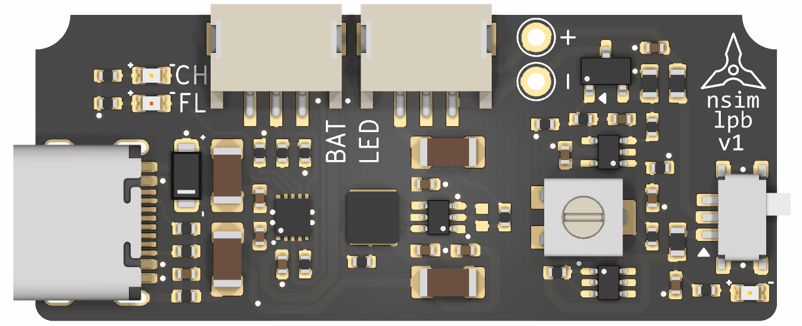
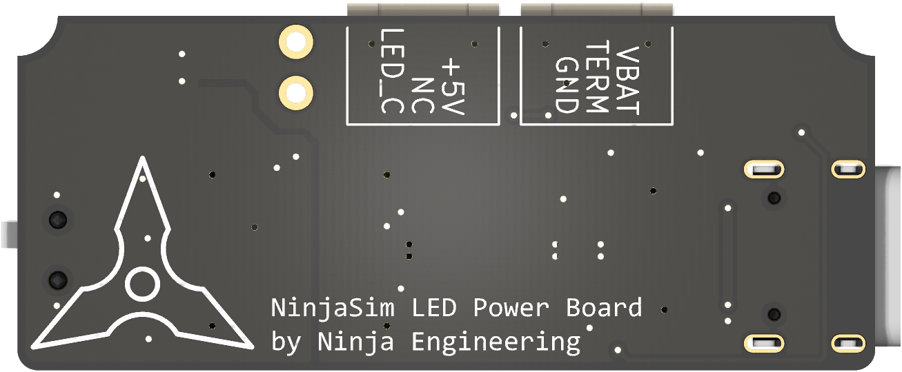
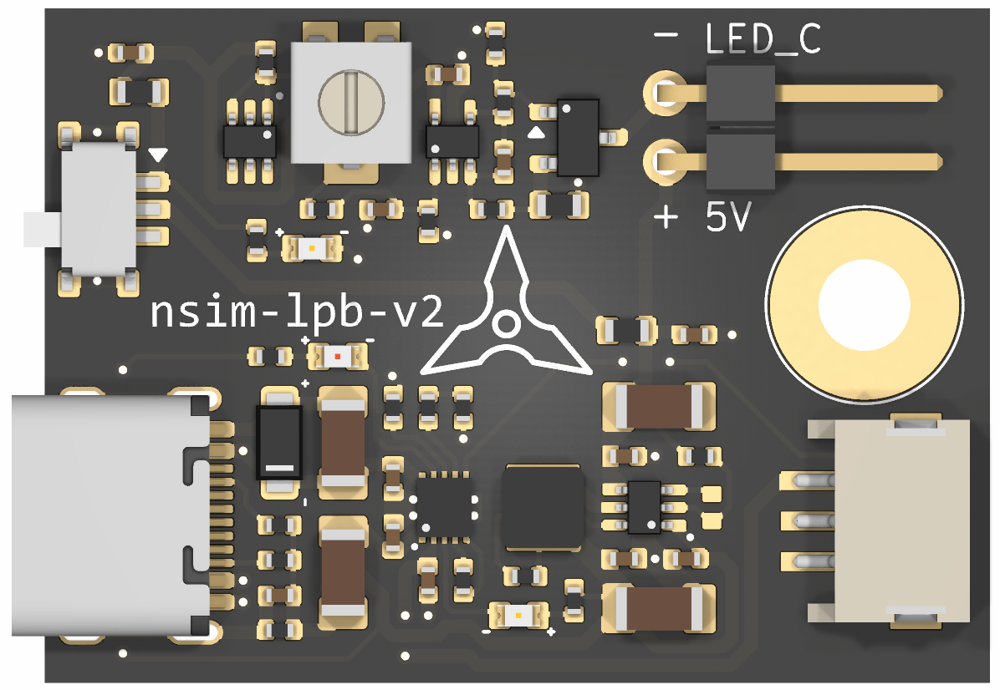
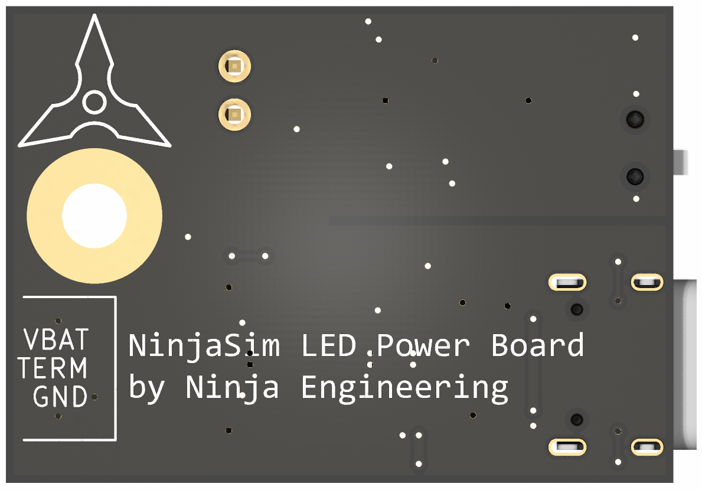

# NinjaSim
A repository for flight simulation stuff, ranging from hardware designs, firmware for said designs, keybind configurations and helpfull scripts.

- `hw/` store KiCad hardware designs and mechanical models.
- `fw/` store firmware for hardware designs.
- `cfg/` store simulator keybinds, HOTAS configurations and OpenTrack profiles. 
- `tools/` store scripts etc.

## Relevant Repostories
- [`NinjaEcadLib`](https://github.com/ninjanymo/ninjaecadlib) - Component library for all hardware designs.
- [`NinjaSim-CDT`](https://github.com/ninjanymo/ninjasim-cdt) - Documentation on how to integrate custom projects into Virpil Control's CDT range of products.

# Overview

## NinjaSim LED Power Board
An adjustable constant current LED driver board desiged for driving three external series IR LEDs for OpenTrack head tracking.

Adjustable current regulation is achieved through an anlog _Voltage-to-Current_ (V-I) regulator. Battery charging is achieved through TI's BQ25185 integrated charger IC where low charging currents are set for safe operation.

Both versions are 2-layered designs with conservative constraints and make extensive use of JLCPCB _Basic Parts_ for cost effective manufacturing.

The two versions differ only in form factor and connector choices.

### `hw/nsim-lpb-v1`

  
  

### `hw/nsim-lpb-v2`

  
  

