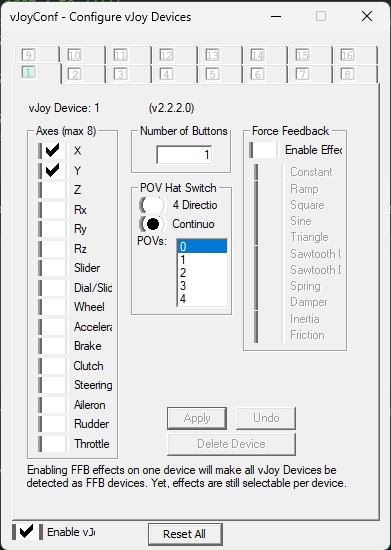
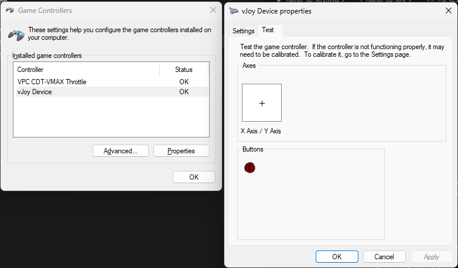

# nano-to-joy

A very basic guide on how to:

- Make an Arduino Nano read two potmeters and a button, and send it over serial.
- Read the serial in a simple python script and transport it over to vJoy.
- Make vJoy present the values to Windows as a joystick HID device.

## \#1 - Wiring the Hardware

The joystick sits on a premade breakout board with labeled pins that are connected to the Nano as follows:

| Joystick | Nano |
|----------|------|
| GND      | GND  |
| +5V      | 5V   |
| VRX      | A0   |
| VRY      | A1   |
| SW       | D2   |

## \#2 - Identifying the Nano COM Port
Plug in the Nano and open Windows' Device Manager. Look under `Ports (COM & LPT)` for something like `USB SERIAL`.

In this case, we see `USB SERIAL CH340 (COM4)` so we know the Nano communicates with Windows over the port `COM4`.

(The `CH340` comes from the Nano being a cheap clone which typically use the cheap CH340 USB to serial chip. A real Arduino Nano may present differently. If that is the case, try to disconnect and reconnect the Nano to identify which COM port it sits on.)

## \#3 - Test the Nano

1. Open Arduino IDE.
2. Under `Select Board` choose the correct COM port (`COM4` in this case).
3. Search for `Nano` and choose `Arduino Nano` when prompted for the board type.
4. Go to `File -> Examples -> 01. Basics` and select `Blink` to load the example blink project.
5. Click the `Verify` button (top left check mark).
6. Click the `Upload` button (top left arrow).
7. If that doesn't work, go to `Tools -> Processor` and change it to `ATmega328P (Old Bootloader)`. Try verifying and uploading again.
8. If that doesn't work, go to `Tools -> Processor` and change it to ATmega168. Try verifying and uploading again.

You should no see your Nano blinking and an `Avrdude done.  Thank you.` message in the Arduino IDE.

If that doesn't work, something is wrong with your Nano or the COM port is off.

## \#4 The Nano Code

In the Arduino IDE change the code to:


```cpp
void setup() {
  Serial.begin(115200);     // Start the serial port at baudrate 115200.
  pinMode(2, INPUT_PULLUP); // Set the Nano pin with the button to an input with pull-up.
}
 
void loop() {
  // The Nano has an 10-bit ADC so it will report values from 0 to 1023 (2^10).
  // vJoy expects a value ranging from 1 to 32737
  // Thus, multiply the Nano analog value by 32 and add 1 after reading:
  long x = analogRead(A0) * 32 + 1;
  long y = analogRead(A1) * 32 + 1;

  // Read the button:
  int b = !digitalRead(2);  // 1 = pressed
 
  // Print the values to serial:
  Serial.print(x);
  Serial.print(',');
  Serial.print(y);
  Serial.print(',');
  Serial.println(b);
 
  delay(10); // Add a 10ms delay so this happens roughly 100 times a second.
}
```

Do the verify and upload procedure, then click `Tools -> Serial Monitor`. You should see something like this:
```
16641,16673,0
16641,16673,0
16641,16673,0
16641,16673,0
16641,16673,0
16641,16673,0
```

Where the two first values (the analog readings) change when the potmeters are adjusted and the third value (the button state) change to a `1` when the button is pressed.

If the values don't change, something is off with the wiring.

### IMPORTANT
Close the Arduino Serial Monitor by clicking the `X` next to `Serial Monitor` in the Arduino IDE.
COM ports can only be claimed by one thing at the time, so if the Arduino IDE is sitting on it, the python script wont be able to claim it later.

## \#5 Installing and Configuring vJoy
vJoy is a very old tool, but thankfully the legends at Brunner Elektronik AG has maintained it and gotten the drivers signed. Shoutout to them.

1. Grab vJoy from [github.com/BrunnerInnovation/vJoy/releases](https://github.com/BrunnerInnovation/vJoy/releases) and install it.
2. Run `C:\Program Files\vJoy\x64\vJoyConf.exe` as administrator. (It may take some time before the windows appears, like a minute, so be patient).
3. In the `vJoyConf` window that opens, click the tab marked `1`and un-tick everything except `X` and `Y`, set `Number of buttons` to `1` and click `apply`:

<p align="center">
  
</p>

## \#6 Test vJoy
Hit `windows key + R`, type `joy.cpl` and hit `enter` to open Windows` native Game Controller tester.

Double click `vJoy Device` which should open `vJoy Device properties`, where the X/Y axes shoul be presented along with one button. Don't worry, they won't work just yet.

**Leave this window open.**

<p align="center">
  
</p>


## \#7 Python and Packages
A functioning installation of python is required for this. A functioning installation of `pip` is also necessary.

Some python libraries are also necessary. In a terminal, run:
```
pip install pyserial
```
and
```
pip install pyvjoy
```

## \#8 The Python Script
Start a new python file, in this case `nano-to-joy.py` and add this:

```python
import serial
import pyvjoy

# Set serial port to COM4 with baudrate 115200:
ser = serial.Serial("COM4", 115200) 

# Create a VJoyDevice Object from vJoy`s #1 we configured earlier:
j = pyvjoy.VJoyDevice(1)

# Discard the first line read from serial as it may be incomplete:
ser.readline()

while True:
    # Read the string from serial, split it into three objects separated by ","
    # and cast it into the integers x, y and b:
    x, y, b = map(int, ser.readline().split(b","))
    # Send the values to the VJoyDevice object:
    j.set_axis(pyvjoy.HID_USAGE_X, x)
    j.set_axis(pyvjoy.HID_USAGE_Y, y)
    j.set_button(1, b)
```

Save the file, open a terminal and run `python nano-to-joy.py`.

Go back to Windows` Game Controller Tester and you should see the values change when you manipulate the potmeter and button == **SUCCESS**.

### Troubleshooting:
If you try to flash the Nano and get:

```
Error: unable to open port COM4 for programmer arduino

Avrdude done.  Thank you.
Failed uploading: uploading error: exit status 1
```

Quit your python script because the python script is sitting on the COM port.